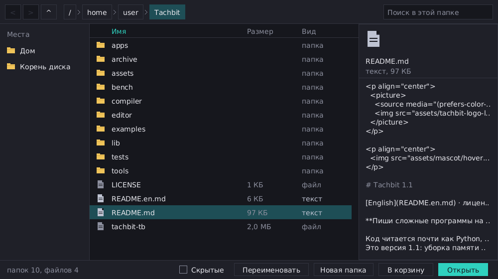
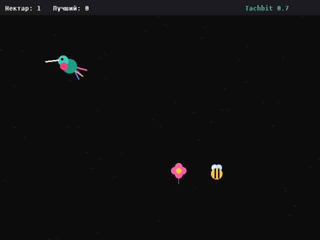
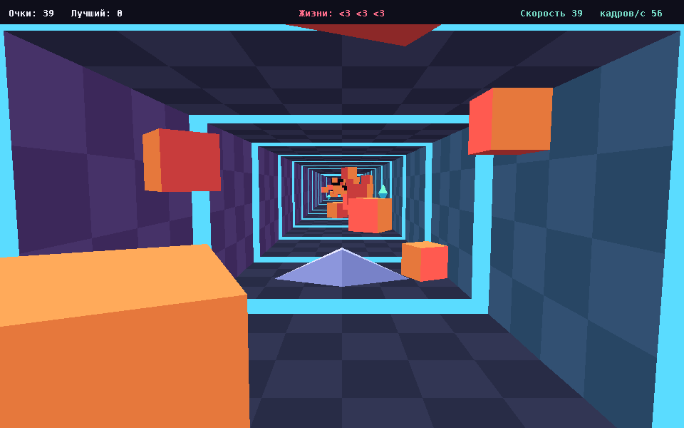

<p align="center">
  <picture>
    <source media="(prefers-color-scheme: dark)" srcset="assets/tachbit-logo-dark.svg">
    
  </picture>
</p>

<p align="center">
  
</p>

# Tachbit 1.1

[English](README.en.md) · лицензия MIT ([LICENSE](LICENSE))

**Пиши сложные программы на понятном языке — и получай настоящую быструю программу, а не макет.**

Код читается почти как Python, а работает как C. Компилятор сам делает трудную часть (память, ядра, проверки) и, если что-то не так, объясняет ошибку простыми словами ещё до запуска. Подходит и для больших приложений и игр, и для своего ядра ОС.
Это версия 1.1: уборка памяти — ненужные obj, списки, dict и тексты отдаются сами (смотри «Уборка памяти (1.1)»). В 1.0: каналы между потоками, `move`, `enum` и `match`, время, JSON и `http_get` (смотри «Новое в 1.0»). В 0.9 «защита» компилятор научился сам ловить гонки между ядрами, вечные замки и ярлыки, которые повели бы в пустоту (смотри «Защита (0.9)»). В 0.7 «скорость» появились: `on all cores` и `shared` (цикл сразу на всех ядрах), `obj ... by columns` (хранение колонками), `temp` (временная память), `by vec` (SIMD), куски `each piece in data by N`, блок `together`, `background` и `.wait`. С 0.5 компилятор Tachbit написан на самом Tachbit и собирает сам себя. В языке есть функции, типы, условия, циклы, списки, `dict`, объекты `obj`, текст, ярлыки `link`, несколько выходов `gives`, ошибки `fail` / `try` / `or` / `else err`, модули `use` / `modpub` / `modpri` и первая стандартная библиотека.

Tachbit работает сам, без стартера на C:
- `compiler/` — компилятор на самом Tachbit. Он собирает сам себя.
- `compiler/seed/tb.c` — «семя»: C-код этого же компилятора, который сделал сам Tachbit. Из него на новом компьютере получается первый `tb`, а дальше `tb` собирает себя из `compiler/*.tb`.

От C остался только `cc` (clang на Mac): Tachbit пишет C, а `cc` превращает его в программу для процессора. Так же устроены многие языки (Nim, ранний C++). Свой перевод прямо в команды процессора — шаг на будущее.

## Папки

| Папка | Что там |
|---|---|
| `compiler/` | компилятор Tachbit, написанный на самом Tachbit; `seed/tb.c` — его семя |
| `editor/vscode/` | расширение для VS Code: цвета, запуск по F5, ошибки в коде |
| `examples/` | примеры программ на Tachbit |
| `tests/` | проверки компилятора |
| `bench/` | замер скорости против C и Python |
| `tools/` | синхронизация с Mac и служебные скрипты (в том числе свой компоновщик ядра `elf_link.py`) |
| `assets/` | логотип, значки и маскот Tachbit (колибри, `assets/mascot/`) |
| `lib/` | общие библиотеки на самом Tachbit: `lib/ui.tb` — кнопки, списки, окна-вопросы (`use ui` из любой папки) |
| `apps/` | приложения на самом Tachbit: `apps/files` — файловый менеджер в окне, `apps/folders` — менеджер папок в терминале, `apps/game` — игра «Колибри и нектар», `apps/corridor` — 3D-игра «Звёздный коридор» |

Всё в этих папках — наше. Чужое только то, что ставится отдельно: `cc`/clang (переводит C в команды процессора), `python3` (для компоновки ядра), `qemu` (запуск ядра), VS Code. Файлы `tachbit`, `tachbit-tb` и `hello.txt` в корне — собранные или временные, их нет в репозитории, можно удалять.

## Самый простой запуск: команда `tb`

Один раз (и после каждого `git pull`):
```
./tools/install.sh
```
Потом из любой папки:
```
tb new shop        # новый проект: папка shop/ с main.tb
tb start shop      # собрать и запустить проект
cd shop && tb start   # без имени — проект в текущей папке
tb start hello.tb  # или просто один файл (можно без .tb)
```
`install.sh` собирает `tb` из семени.

**Windows.** Нужен компилятор C из MinGW-w64: `winget install -e --id MartinStorsjo.LLVM-MinGW.UCRT` (или MSYS2 с gcc). Потом в PowerShell из папки Tachbit:
```
powershell -ExecutionPolicy Bypass -File tools\install.ps1
```
Он собирает `tb.exe`, кладёт его в `%USERPROFILE%\.tachbit\bin` и добавляет эту папку в PATH. Окно (`window_open`) работает через GDI; ядро без ОС (`tachbit bare`) пока собирается только на Linux и Mac.

Ошибки в терминале цветные: место жирным, сама ошибка красным. `NO_COLOR=1` выключает цвет.

## VS Code

```
./tools/install_vscode.sh
```
Потом закрой VS Code полностью (Cmd+Q) и открой заново. В файлах `.tb` будет:
- цвета: команды, типы, функции, числа, текст, комментарии, слова скорости (`on all cores`, `background`, `temp` ...);
- **F5** или **Cmd+Enter** (или ▶ сверху справа) — запустить файл в терминале снизу;
- при сохранении файл проверяется, и ошибки подчёркиваются красным прямо в строке (и видны в «Проблемах»);
- заготовки: напиши `main`, `func`, `each`, `cores`, `bg` и нажми Tab;
- `//` комментирует строку по Cmd+/, блоки сворачиваются по отступам.

### Значок файлов .tb в Finder (Mac)

```
./tools/install_mac_icons.sh
```
Ставит маленькую программу `~/Applications/Tachbit.app`: у файлов `.tb` в Finder появляется свой значок, а двойной щелчок открывает их в VS Code. Значок — `assets/tachbit-file-icon.svg` (и `-1024.png`).

### Свои цвета: тема Tachbit Dark / Light

В расширении две темы в цветах логотипа. Включить: Cmd+K, потом Cmd+T → **Tachbit Dark** (или **Tachbit Light**).
Цвета лежат в `editor/vscode/themes/tachbit-dark.json` и `tachbit-light.json`: блок `colors` — окно редактора, блок `tokenColors` — цвета слов кода. Поменял цвет → `./tools/install_vscode.sh` → Cmd+Q и открыть VS Code заново.

| Что | Тёмная | Светлая |
|---|---|---|
| команды (`if`, `each`, `func` ...) | `#4fb3ac` | `#1f6f6a` |
| слова скорости (`on all cores`, `danger`, `lock` ...) | `#e8c468` | `#a8740c` |
| типы и встроенные функции | `#8fd3cc` | `#2a7f7a` |
| имена функций | `#ffffff` | `#1c1c1e` |
| текст в кавычках | `#e3b98a` | `#9a5b22` |
| числа | `#f08f73` | `#c4472b` |
| комментарии | `#7d7d85` | `#8a8a90` |

Значок файлов и расширения — `editor/vscode/icon.svg` / `icon.png`; логотип в начале этого файла — `assets/tachbit-logo-*.svg`. Чтобы сменить лого, замени эти файлы своими (с теми же именами).

Готовая программа проекта лежит в `shop/build/shop`. Остальные модули проекта (`use money`) кладутся рядом с `main.tb`.

## Файловый менеджер «Файлы» и библиотека окон ui

<p align="center"></p>

`apps/files/main.tb` (около 600 строк) — файловый менеджер в окне: места слева (Дом, Рабочий стол, Документы, Загрузки),
путь сверху (каждая папка — кнопка), назад / вперёд / выше, список со значками, размером и видом, сортировка
по имени или размеру (щелчок по шапке), полоса прокрутки, просмотр справа (текст, картинка PNG, что лежит в папке),
«Новая папка» (сразу можно написать имя), «Переименовать», «В корзину» (с вопросом; на Mac — в Корзину, на Linux — в `~/.local/share/Trash`), скрытые файлы.
Поиск: просто начни печатать — список оставит только подходящие имена (большие и маленькие буквы, русские тоже, без разницы).
Двойной щелчок по файлу открывает его той программой, что стоит в системе. Колёсико листает список.
Клавиши: ↑ ↓, Page Up / Page Down, Home / End, Enter — открыть, Backspace — выше, ← → и боковые кнопки мыши — назад и вперёд.

| Горячие клавиши (на Linux и Windows вместо Cmd — Ctrl) | |
|---|---|
| Cmd+↑ / Cmd+↓ | выше / открыть |
| Cmd+[ / Cmd+] | назад / вперёд |
| Cmd+C, Cmd+X, Cmd+V | копировать, вырезать, вставить (копия получает имя «… копия») |
| Cmd+Backspace или Delete | в корзину |
| F2 | переименовать |
| Cmd+Shift+N | новая папка |
| Cmd+F | поиск (Esc — очистить) |
| Cmd+Shift+. | показать скрытые |
Окно можно тянуть за край — всё раскладывается заново.
```
tb start apps/files
apps/files/build/files ~/Desktop
```

Кнопки и списки **не встроены в компилятор**: это библиотека `lib/ui.tb` на самом Tachbit.
Она только рисует прямоугольники и буквы (`draw_rect`, `draw_font`) и смотрит на мышь и клавиши.
Шрифт берёт системный (на Mac — San Francisco, Helvetica или Arial; на Linux — DejaVu; на Windows — Segoe UI),
свой можно дать так: `ui.use_font(u, "шрифт.ttf")` или переменной `TB_UI_FONT`; размер — `u.fs = 16`.
`./tools/install.sh` кладёт её в `~/.tachbit/lib`, и `use ui` находит её из любой папки
(сначала `use` ищет файл рядом с программой, потом в папке `TB_LIB`, потом в `~/.tachbit/lib`).
```
use ui

func main()
    try window_open(600, 300, "Привет")
    u = ui.start()
    on = false
    repeat while window_alive()
        ui.frame(u)                                  // в начале кадра
        clear_window(u.bg)
        if ui.button(u, 20, 20, 140, 30, "Нажми")
            ui.ask(u, "Точно?", "Это окно-вопрос", "Да", "Нет")
        on = ui.check(u, 20, 70, "Галочка", on)
        if ui.answer(u) == 1
            print("сказали да")
        ui.end_frame(u)                              // в конце: вопрос поверх всего
```
Что есть: `button`, `button_main` (цветная), `button_off` (серая), `check` (галочка), `row` (строка списка:
1 — щелчок, 2 — двойной щелчок), `scrollbar` (тянуть мышью или щёлкнуть выше/ниже), `ask` / `answer`
(окно «да / нет», Enter и Esc), `panel`, `label`, `label_center`, `txt` (текст), `big_text` (заголовок), `text_w` (ширина), `fit` (длинный текст кончается на `..`),
`key_pressed` и `key_repeat` (стрелка повторяется, если держать), `shortcut(u, "cmd+shift+n")` (горячая клавиша), `field` (поле ввода: щёлкни и печатай,
Enter — `u.entered`, Esc — хватит), `wheel_scroll` (листать колёсиком), `u.back_press` / `u.fwd_press` (боковые кнопки мыши). Цвета меняются так: `u.accent = rgb(255, 120, 80)`.
Так устроено «немедленное» рисование: каждый кадр программа заново зовёт `ui.button`, и функция сразу рисует
кнопку и отвечает, нажали ли. Хранить кнопки где-то не нужно.


## Приложение «Папки» (написано на Tachbit)

Маленький менеджер папок в терминале: `apps/folders/main.tb`.
```
tb start apps/folders                 # собрать и открыть текущую папку
apps/folders/build/folders ~/Desktop  # открыть нужную папку
```
Готовая программа `apps/folders/build/folders` — один файл, файлы компилятора ей не нужны: её можно скопировать куда угодно.
Команды: число — открыть папку или посмотреть файл, `..` наверх, `n имя` новая папка, `f имя` новый файл, `r 3 имя` переименовать, `d 3` в Корзину, `m 3 папка` перенести, `c 3` копия, `e 3` открыть в редакторе, `x 3` запустить `.tb` или проект, `/текст` поиск, `.` скрытые файлы, `h` домой, `q` выход.

Для неё в язык добавлены функции для папок: `list_dir(папка)` (имена, у папок `/` в конце, папки первыми), `is_folder`, `make_folder`, `move(откуда, куда)`, `remove` (файл или пустая папка), `file_size`, `env("HOME")`. `list_dir`, `make_folder`, `move`, `remove` могут закончиться ошибкой: пиши `try` или `else err`.

## Окно и игры

Tachbit умеет открыть окно и рисовать в нём: этого хватает для простых игр.
Окно на Mac — Cocoa, на Linux — X11, на Windows — обычное окно Win32.

Рисует видеокарта: на Mac — Metal, на Linux и Windows — Vulkan. Каждая фигура кадра
(прямоугольник, круг, буква) записывается одной строкой в память видеокарты, и видеокарта рисует
их все разом — по тем же правилам точек, что и процессор, точка в точку. Ставить ничего не надо:
Metal есть на каждом Mac, Vulkan приходит с драйвером видеокарты. Нет Vulkan (или нет видеокарты) —
Tachbit сам рисует на процессоре, как раньше; программа об этом не знает.

3D тоже считает видеокарта: сетка один раз ложится в её память, а на каждый `draw_mesh` процессор
передаёт только «где стоит и как повёрнута» (12 чисел). Повороты, камеру и проекцию видеокарта считает
в целых числах, без дробей: так кадр одинаков на любой видеокарте и совпадает с процессором точка в точку.
У закрытых сеток (куб, шар, комната) задние грани не считаются вовсе — их всё равно не видно.
Большая сетка (больше 256 треугольников) сама режется на куски по месту: куски вдали считает видеокарта,
куски у самой камеры — процессор (с обрезкой у камеры), а куски за спиной и за краем экрана не считаются.

| Переменная | Что делает |
|---|---|
| `TB_GPU=0` | рисовать на процессоре |
| `TB_GPU_INFO=1` | сказать при запуске, чем рисуем |
| `TB_GPU_CHECK=1` | рисовать и там и там и сверять каждый кадр точка в точку (`tests/run_gpu.sh`) |
| `TB_GPU_NOMESH=1` | 3D считать на процессоре (видеокарта только рисует готовые треугольники) |

<p align="center"></p>

Игра «Колибри и нектар» (`apps/game/main.tb`, около 140 строк): стрелки — лететь, собирай цветы, не попадайся пчёлам.
```
tb start apps/game
```

<p align="center"></p>

3D-игра «Звёздный коридор» (`apps/corridor/main.tb`, около 250 строк, только встроенные слова): корабль летит
по тоннелю всё быстрее, стрелки — уворачиваться от вращающихся блоков и ловить кристаллы, три жизни.
```
tb start apps/corridor
tb run apps/corridor/main.tb demo     # летит сам
```

Самая маленькая программа с окном:
```
func main()
    try window_open(400, 300, "Привет")
    x = 200
    repeat while window_alive()          // кадр за кадром, 60 раз в секунду
        if key_down("left")
            x -= 4
        if key_down("right")
            x += 4
        clear_window(rgb(20, 20, 30))
        draw_circle(x, 150, 20, rgb(47, 209, 191))
        draw_text(10, 10, "Стрелки двигают круг", 1, rgb(255, 255, 255))
```

| Что | Как пишется |
|---|---|
| открыть окно | `try window_open(ширина, высота, "заголовок")` |
| следующий кадр | `repeat while window_alive()` — показывает нарисованное, принимает клавиши, держит 60 кадров в секунду; `false`, когда окно закрыли |
| цвет | `rgb(255, 95, 162)` — красный, зелёный, синий от 0 до 255 |
| залить всё окно | `clear_window(цвет)` |
| точка, прямоугольник, круг, линия | `draw_pixel(x, y, цвет)`, `draw_rect(x, y, ш, в, цвет)`, `draw_circle(x, y, радиус, цвет)`, `draw_line(x1, y1, x2, y2, цвет)` |
| треугольник (первый шаг к 3D) | `draw_triangle(x1, y1, x2, y2, x3, y3, цвет)` — углы в любом порядке; видеокарта и процессор рисуют его точка в точку одинаково, у соседних треугольников общая сторона рисуется один раз. Пример: `examples/triangles.tb` |
| 3D: сетка | `m = mesh_new()` — пустая сетка; `mesh_add(m, x1, y1, z1, x2, y2, z2, x3, y3, z3, цвет)` — треугольник в сетку (x вправо, y вверх, z вперёд) |
| 3D: нарисовать | `draw_mesh(m, x, y, z, поворот)` — сетка в точке мира, повёрнута вокруг вертикали на столько градусов; ближнее закрывает дальнее (глубина) |
| 3D: камера | `camera(x, y, z, куда_x, куда_y, куда_z)` — где стоит и куда смотрит (угол обзора 60°). Без неё камера в (0, 0, -5) и смотрит в (0, 0, 0). Пример: `examples/cube.tb` |
| текст (и русский) | `draw_text(x, y, "текст", размер, цвет)` — буква 8×16, размер 2 — вдвое крупнее |
| клавиши | `key_down("left")` — `left right up down space enter escape backspace tab shift`, `cmd ctrl alt delete home end pageup pagedown`, `f1`…`f12`, буквы `"a"`…`"z"`, цифры и знаки `[ ] . , / - = ;`. `cmd` — это Command на Mac и Ctrl на Linux и Windows: одна программа с горячими клавишами для всех |
| мышь | `mouse_x()`, `mouse_y()`, `mouse_down()` (короткое касание тачпада тоже ловится); `mouse_wheel()` — на сколько шагов повернули колёсико с прошлого раза: плюс вперёд (от себя), минус назад, 0 — не крутили (два пальца на тачпаде Mac тоже); `mouse_back()`, `mouse_forward()` — боковые кнопки мыши |
| шрифты TTF | `f = try load_font("шрифт.ttf")` (и сборники `.ttc`) → номер шрифта; `draw_font(f, x, y, "текст", размер, цвет)` — сглаженные буквы, размер в точках, `\n` — новая строка (высота строки — размер × 5/4); `text_width(f, "текст", размер)` — ширина строки в точках. Свой чтец TrueType внутри Tachbit, без чужих библиотек; шрифты CFF (`.otf`) пока не читаются |
| набранный текст | `typed_text()` — буквы, набранные с прошлого раза, русские тоже (`""` — ничего); стрелки, Enter и Backspace сюда не попадают, их смотрит `key_down` |
| время и случайность | `time_ms()`, `wait_ms(100)`, `random(1, 6)` (оба конца входят) |
| картинки PNG | `hero = try load_image("hero.png")` → номер картинки; `draw_image(hero, x, y)`; `image_w(hero)`, `image_h(hero)`. Прозрачные точки (меньше половины) не рисуются |
| частота кадров | `frame_ms()` — сколько мс шёл прошлый кадр, дробное число (`x += speed * frame_ms() / 1000`, где `x` и `speed` дробные — одна скорость при любой частоте); `fps()` — кадров в секунду; `set_fps(30)` — своя частота, `set_fps(0)` — сколько успеет, не ждать экран. По умолчанию — как у экрана (60 Гц — 60 кадров, 120 Гц — 120) |
| размер окна | `window_w()`, `window_h()` (попробуй: `tb run examples/window_demo.tb`). Как только программа спросила размер, окно можно тянуть мышью: старое остаётся в левом верхнем углу, новое место чёрное |

Точка (0, 0) — левый верхний угол, `y` растёт вниз.

Замер 3D (`bench/cubes.tb N`: N × N вращающихся кубов, 600 кадров без ожидания экрана):
`TB_FPS_FREE=1 tb run bench/cubes.tb 120`. Intel Mac с AMD Radeon Pro 5500M, окно 1280×720:

| Кубов | Треугольников в кадре | Было (всё 3D на процессоре) | Стало (3D на видеокарте) |
|---|---|---|---|
| 3 600 | 43 200 | 86 кадров/с | 963 кадра/с |
| 14 400 | 172 800 | 23 кадра/с | 487 кадров/с (84 млн треугольников/с) |

Процессору остаётся около 1 мс на кадр — это сама программа (14 400 вызовов `draw_mesh`).

Чего пока нет для игр: звука, текстур и света в 3D, убрать треугольники из сетки (`mesh_clear`),
геймпада, крупного шрифта. Для приложений с окнами кнопки, списки, поле ввода и прокрутка колёсиком есть в библиотеке `lib/ui.tb` (см. «Файлы»).

Замер (`bench/game.tb`: 1000 кадров 640×480, на каждом 500 пчёл, 100 цветов и текст): `TB_FPS_FREE=1 tb run bench/game.tb` — без ограничения 60 кадров/с. Linux-сервер: 1763 кадра в секунду (0.57 мс на кадр), то есть запас почти в 30 раз до обычных 60 кадров.

Логика игры против C (`bench/physics.tb` и `bench/physics_pure.c`, без окна): 10 000 шаров, 200 кадров, движение, гравитация, отскок от стен, сетка 125×125 и столкновения с соседями. Ответ у обоих одинаковый: 936 104 столкновения. Linux-сервер, лучшее из 20: Tachbit 0.226 с, C 0.235 с (clang: 0.221 и 0.218).

Проверка края списка не пропадает, компилятор убирает её только там, где может доказать, что номер правильный:
- **билет на входе**: в `count i from A to B` края для `xs[i]`, `xs[i + 1]` проверяются один раз до цикла;
- **мяч в коробке**: компилятор знает пределы чисел — `max(0, min(c, 124))` всегда от 0 до 124, `i % 100` от 0 до 99, у своей функции пределы всех её `return`;
- **пломба**: если в список номеров кладут только числа из коробки (`order.add(i)`, `order[k] = i`) и список никуда не уходит, то любое число из него тоже в коробке, и `xs[order[p]]` проверяется один раз до цикла.

Пломба срывается, если список отдали в функцию, сделали `idx[3] += 20`, взяли ярлык на ячейку и т.п. — тогда проверка остаётся на каждом шаге (тесты `tests/err/seal_*.tb`, `box_edge.tb`).

## Маскот: колибри

Колибри маленькая, а крыльями машет до 80 раз в секунду и умеет точно зависать на месте. Так и Tachbit: лёгкий, быстрый и точный.

| | | |
|:---:|:---:|:---:|
| <br>зависает | <br>в полёте | <br>смотрит на нас |
| <br>садится | <br>портрет | <br>простая |

Все картинки лежат в `assets/mascot/`.

## Как собрать и запустить

```
./tools/build_tb.sh            # получится ./tachbit-tb (то же, что команда tb)
./tachbit-tb run examples/hello.tb
```

На Mac `cc` — это clang, ставится командой `xcode-select --install`.

| Команда | Что делает |
|---|---|
| `tb run файл.tb` | сделать программу и сразу запустить (сама программа кладётся в `~/.tachbit/run`, рядом с файлом ничего лишнего) |
| `tb build файл.tb` | сделать программу рядом с файлом (`examples/hello`) |
| `tb check файл.tb` | только найти ошибки |
| `tb c файл.tb` | показать, какой C получился |
| `tb tree файл.tb` | показать дерево программы |
| `tb tokens файл.tb` | показать токены |

## Как выглядит код

```
func add(a: int, b: int)
    return a + b

func main()
    total = add(a: 7, b: 8)
    print(total)
```

Программа начинается с `func main()`. Блоки задаются отступом, как в Python.

## Учебник: пишем магазин по шагам

Одна программа растёт от «привет» до магазина с корзиной, файлом, модулями и всеми ядрами.
Каждый шаг лежит в `examples/learn/` и запускается сразу:
```
tb run examples/learn/1_hello.tb
```
Совет: не копируй, а набери код сам и поменяй что‑нибудь — так запоминается в разы лучше.

### Шаг 1. Переменные и вывод

```
func main()
    shop = "Колибри"
    price = 120
    many = 3
    total = price * many
    print("Добро пожаловать в магазин", shop)
    print(many, "чашки чая стоят", total, "сом")
```
- Программа всегда начинается с `func main()`.
- `shop = "Колибри"` — переменная. Тип (`text`, `int`) Tachbit понимает сам.
- Блоки задаются отступом в 4 пробела, как в Python. Скобок `{ }` нет.
- `print` печатает всё через пробел.

Вывод:
```
Добро пожаловать в магазин Колибри
3 чашки чая стоят 360 сом
```

### Шаг 2. Свой тип товара: obj и список

```
obj Item
    name: text
    price: int
    left: int

func main()
    items = list Item
    items.add(Item(name: "Чай", price: 120, left: 10))
    items.add(Item(name: "Кофе", price: 200, left: 4))
    items.add(Item(name: "Сок", price: 90, left: 0))

    print("Товары:")
    each it in items
        if it.left > 0
            print("  " + it.name + " — " + it.price + " сом, осталось " + it.left)
        else
            print("  " + it.name + " — нет в наличии")
```
- `obj Item` — свой тип с качествами `name`, `price`, `left`. Пишется снаружи функций.
- `Item(name: "Чай", price: 120, left: 10)` — создать товар.
- `items = list Item` — пустой список товаров, `.add(...)` кладёт в конец.
- `each it in items` — пройти по каждому товару. `it.left` — качество товара.
- `if / else` — условие. Текст склеивается через `+`, числа в нём превращаются в цифры сами.

### Шаг 3. Функции и корзина (dict)

```
obj Item
    name: text
    price: int
    left: int

// ищет товар по имени: отдаёт номер в списке или -1
func find_item(items: list Item, name: text)
    count i from 0 to len(items) - 1
        if items[i].name == name
            return i
    return -1

// сумма корзины: сколько штук каждого товара
func cart_total(items: list Item, cart: dict text int)
    total = int 0
    each name in cart
        at = find_item(items, name)
        if at >= 0
            total += items[at].price * cart[name]
    return total

func main()
    items = list Item
    items.add(Item(name: "Чай", price: 120, left: 10))
    items.add(Item(name: "Кофе", price: 200, left: 4))

    cart = dict text int
    cart["Чай"] = 2
    cart["Кофе"] = 1
    print("К оплате:", cart_total(items, cart), "сом")
```
- `func find_item(items: list Item, name: text)` — функция с параметрами. Тип параметра пишется после `:`.
- `return` отдаёт ответ. Тип ответа Tachbit тоже понимает сам.
- `count i from 0 to len(items) - 1` — счётчик, последнее число тоже входит.
- `cart = dict text int` — словарь «название → сколько штук». `cart["Чай"] = 2` кладёт, `cart[name]` достаёт.
- `each name in cart` идёт по ключам словаря.
- `total = int 0` — переменная с явным типом (полезно, когда начинаешь с нуля).

### Шаг 4. Ошибки: fail, else err, or

```
obj Item
    name: text
    price: int
    left: int

func find_item(items: list Item, name: text)
    count i from 0 to len(items) - 1
        if items[i].name == name
            return i
    return -1

// купить: если товара нет или мало — ошибка с понятным текстом
func buy(items: list Item, name: text, many: int)
    at = find_item(items, name)
    if at < 0
        fail "нет такого товара: " + name
    if items[at].left < many
        fail "осталось только " + items[at].left + " шт. товара " + name
    items[at].left -= many
    return items[at].price * many

func main()
    items = list Item
    items.add(Item(name: "Чай", price: 120, left: 10))
    items.add(Item(name: "Кофе", price: 200, left: 4))

    paid = buy(items, "Чай", 3) else err
        print("не вышло:", err)
    print("заплатили", paid)

    paid2 = buy(items, "Кофе", 9) else err
        print("не вышло:", err)

    paid3 = buy(items, "Пирог", 1) or 0
    print("за пирог:", paid3)
```
- `fail "текст"` — функция заканчивается ошибкой.
- Такую функцию нельзя вызвать «просто так»: компилятор попросит решить, что делать с ошибкой.
  - `x = f() else err` и блок ниже — свой ответ на ошибку, в `err` её текст;
  - `x = f() or 0` — при ошибке взять запасное значение;
  - `x = try f()` — передать ошибку выше (в `main` программа остановится с текстом ошибки).
- `items[at].left -= many` меняет товар прямо в списке.

Вывод:
```
заплатили 360
не вышло: осталось только 4 шт. товара Кофе
за пирог: 0
```

### Шаг 5. Сохранить в файл и загрузить

```
obj Item
    name: text
    price: int
    left: int

// сохранить: одна строка на товар, части через ;
func save(items: list Item, path: text)
    out = ""
    each it in items
        out += it.name + ";" + it.price + ";" + it.left + "\n"
    try write_file(path, out)

// загрузить: разрезать текст обратно на товары
func load(path: text) gives items: list Item
    content = try read_file(path)
    each line in split(content, "\n")
        if trim(line) == ""
            skip
        parts = split(line, ";")
        price = try to_int(parts[1])
        left = try to_int(parts[2])
        items.add(Item(name: parts[0], price: price, left: left))

func main()
    items = list Item
    items.add(Item(name: "Чай", price: 120, left: 10))
    items.add(Item(name: "Кофе", price: 200, left: 4))
    try save(items, "shop.txt")

    again = try load("shop.txt")
    print("Из файла:", len(again), "товара")
    each it in again
        print("  " + it.name + ": " + it.price + " сом")
```
- `write_file(путь, текст)` и `read_file(путь)` могут сломаться (нет места, нет файла), поэтому перед ними `try`.
- `func load(path: text) gives items: list Item` — у функции есть именованный выход `items`. Он уже пустой список, его можно сразу наполнять, а `return` в конце не нужен.
- `split(текст, ";")` режет текст на части, `trim` убирает пробелы, `to_int` превращает «120» в 120, `skip` — перейти к следующему шагу цикла.

### Шаг 6. Модули: программа из нескольких файлов

`money.tb`:
```
// всё про деньги: скидка и налог
modpub func with_discount(sum: int, percent: int)
    return sum - sum * percent / 100

modpub func with_tax(sum: int)
    return sum + tax(sum)

modpri func tax(sum: int)
    return sum * 12 / 100
```
`6_modules.tb`:
```
use money

func main()
    sum = 1000
    after = money.with_discount(sum, 10)
    print("со скидкой 10%:", after)
    print("с налогом:", money.with_tax(after))
```
- `use money` подключает `money.tb` из той же папки. Если рядом нет — ищет в папке из `TB_LIB`, потом в `~/.tachbit/lib` (туда `install.sh` кладёт общие библиотеки, например `ui`).
- `modpub` — функцию видно другим файлам, `modpri` — только внутри своего.
- Для своего проекта: `tb new shop` сделает папку с `main.tb`, модули кладёшь рядом, запуск `tb start shop`.

### Шаг 7. Быстро: на всех ядрах

```
// миллион продаж: сколько из них крупных (дороже 900 сом)
func main()
    sales = list int
    count i from 1 to 1000000
        sales.add(i * 7919 % 1000)

    shared big = int 0
    each s in sales on all cores
        if s > 900
            big += 1
    print("крупных продаж:", big)
```
- `on all cores` в конце строки цикла — и он идёт сразу на всех ядрах процессора.
- `shared big = int 0` — общая переменная: каждое ядро считает своё, в конце всё складывается.
- Компилятор сам проверяет, что ядра не мешают друг другу (подробнее в разделе «Все ядра»).

### Что дальше

- Таблица «Что умеет» ниже — справочник по всем словам языка.
- Готовые примеры: `examples/` (объекты, ошибки, dict, модули), приложение `apps/folders`, ядро `examples/kernel`.
- Попробуй сам: добавь в магазин команду «покупатель вводит товар с клавиатуры» — пригодится `input()`.

## Что умеет

| Что | Как пишется |
|---|---|
| переменная | `x = 5`, тип узнаётся сам |
| переменная с типом | `total = int 0`, `price = dec 9.5`, `name = text` (пустой текст) |
| нельзя менять | `const name = "Tachbit"` |
| типы | `int` целое, `dec` дробь, `text` текст, `bool` true / false |
| список | `nums = [3, 8, 1]`, пустой: `names = list text`, список списков: `list list int` |
| работа со списком | `nums[0]`, `nums[0] = 5`, `nums.add(7)`, `last = nums.pop()`, `len(nums)` |
| объект | `obj User` и ниже с отступом `name: text`, `age: int` |
| создать объект | `u = User(name: "Ali", age: 20)` — пропущенные качества будут 0 / "" / пустой список |
| качество | `u.age`, `u.age += 1`, `u.tags.add("admin")` |
| ярлык | `hp: link u.age`, потом `hp += 5` меняет `u.age` |
| ярлык в функцию | `func hit(link hp, damage: int)` и вызов `hit(u.age, 3)` |
| несколько выходов | `func divide(a: int, b: int) gives result: int, rest: int` и `q, r = divide(a: 17, b: 5)` |
| изменить | `x += 1`, `-=`, `*=`, `/=` |
| условие | `if` / `else if` / `else`, `and`, `or`, `not` |
| по списку / по буквам | `each n in nums`, `each c in word` |
| счётчик | `count i from 1 to 10` (10 тоже входит) |
| N раз / пока верно | `repeat 3 times`, `repeat while x > 0` |
| дальше / выйти | `skip` / `stop` |
| функция | `func area(w: int, h: int)` и `return w * h`, вызов `area(h: 3, w: 4)` |
| текст | `"итог: " + total`, `word[0]`, `cut(word, 1, 3)` (с 1-й по 3-ю букву), `"a" < "b"` |
| буквы и числа | `code("A")` → 65, `char(66)` → "B", `to_int("42")` → 42 |
| dict | `phones = {"Ali": "555"}`, пустой: `counts = dict text int` (ключ text или int) |
| работа с dict | `phones["Ali"]`, `phones["Vali"] = "777"`, `counts[w] += 1`, `.has(k)`, `.remove(k)`, `.keys()`, `.values()`, `len(d)`, `each k in d` |
| ошибка | `fail "нет файла"` — функция заканчивается ошибкой |
| передать ошибку выше | `x = try f()` — если `f` сломалась, текущая функция тоже ломается (в `main` программа останавливается) |
| запасное значение | `x = f() or 0` |
| свой блок на ошибку | `x = f() else err` и ниже с отступом, например `print(err)` |
| модуль | `use money` — подключить `money.tb` из той же папки |
| видимость | `modpub func total(...)` видно другим файлам, `modpri func` (или без слова) — только своему |
| вызов из модуля | `money.total(price)` или просто `total(price)` |
| вывод | `print(a, b, u, nums)` — через пробел, списки и объекты тоже печатаются |
| числа | `round(2.6)` → `3`, `abs(-7)`, `min(a, b)`, `max(a, b)`, `sqrt(16)`, `to_dec("2.5")` |
| текст | `split(s, ",")`, `join(list, ", ")`, `find(s, "x")` (номер или -1), `replace(s, "a", "b")`, `upper`, `lower` (русские буквы тоже), `trim`, `starts_with`, `ends_with` |
| списки | `sort(nums)` — числа или текст по порядку |
| файлы | `read_file("a.txt")`, `write_file("a.txt", текст)` |
| ввод | `input()` — строка с клавиатуры, `args()` — слова после `tachbit run файл.tb` |
| варианты (1.0) | `enum Status` и ниже с отступом `new`, `paid`; значение `Status.paid` |
| разбор (1.0) | `match s` и ниже `new`, `paid, sent`, `else` — у каждого свой блок; по `int` и `text` тоже |
| канал (1.0) | `ch = channel int`, `ch.send(5)`, `x = ch.receive()`, `ch.close()`, `each x in ch` |
| отдать в фон (1.0) | `background f(move xs)` — список уходит целиком, без копии |
| время (1.0) | `date_now()` → `"2026-11-17 12:30:00"`, `unix_time()`, `time_ms()` |
| интернет и JSON (1.0) | `http_get("https://...")`, `json_get(текст, "users.0.name")`, `json_text(s)` |
| комментарий | `// так` |

Правила, которые стоит знать:

- Объекты и списки передаются как ярлыки: функция, которая получила `u`, меняет того же `u`.
- `7 / 2` у целых даёт `3` (как в C). Нужна дробь — возьми `dec`: `7.0 / 2`.
- Тип ярлыка в `func hit(link hp, ...)` компилятор узнаёт по первому вызову.
- Деление на ноль, номер за пределами списка, пустой объект и `.pop()` у пустого списка останавливают программу с понятной ошибкой, а не портят память.
- Имя внутри блока не может повторять имя снаружи. Так нельзя случайно спрятать переменную.
- Функцию, которая может закончиться ошибкой, нельзя вызвать просто так: компилятор попросит `try`, `or` или `else err`. Могут сломаться `read_file`, `write_file`, `input`, `to_int`, `to_dec` и твои функции, где есть `fail` или `try`.
- `main` должна быть в главном файле, модули — рядом с ним.
- Память компилятор и программа отдают сами: шаг цикла и функция — сразу (смотри «Память шага» и «Память функции»), `temp` — в конце блока, а всё, что живёт дольше, — уборка памяти (смотри «Уборка памяти (1.1)»). Писать `free` не нужно, и программа, которая работает неделями, не растёт по памяти.
- Могут сломаться ещё `http_get` и `json_get`.

## Все ядра: on all cores (0.7)

```
shared found = int 0                 // общая переменная для всех ядер
count n from 1 to 5000000 on all cores
    if is_prime(n)
        found += 1                   // каждое ядро копит своё, в конце складываем
print(found)
```
`each x in nums on all cores` и `count i from a to b on all cores` раздают работу всем ядрам.
Каждое ядро берёт следующий свободный кусок, поэтому ядра не простаивают.

Правила, чтобы ядра не мешали друг другу (проверяет компилятор):
- переменные снаружи цикла внутри только читаются;
- `shared` можно только менять через `+=` и `-=`, а читать после цикла;
- списки и obj снаружи цикла менять нельзя, свои (созданные внутри) можно; в `each x in users on all cores` можно менять и сам элемент `x.age += 1`;
- «снаружи» идёт за данными: `row = matrix[i]`, `u = users[i]`, `ys = xs`, `each p in ps` и результат функции, которой отдали данные снаружи, — тоже снаружи, `row.add(1)` будет ошибкой;
- данные снаружи нельзя отдавать функции, которая их меняет: компилятор смотрит внутрь функции и дальше по цепочке вызовов (`push(xs, i)`, где `push` делает `a.add(x)`, — ошибка; `total(xs)`, который только читает, — можно);
- внутри нельзя `return`, `fail`, `try` и `stop`, а `skip`, `or` и `else err` можно.

`TB_CORES=1 ./программа` запускает её на одном ядре, это удобно для сравнения.

## Новое в 1.0

### Каналы: channel

```
func worker(jobs: channel int, results: channel text)
    each n in jobs                      // берёт, пока канал не закроют
        results.send("готово " + n)

func main()
    jobs = channel int
    results = channel text
    w = background worker(jobs, results)
    count i from 1 to 3
        jobs.send(i)
    jobs.close()
    count i from 1 to 3
        print(results.receive())
```
Канал — очередь между потоками: `.send(x)` кладёт в конец (не ждёт), `.receive()` берёт из начала и ждёт, пока что-то придёт, `.close()` — больше не пишут. `each x in ch` идёт, пока канал не закрыт и не пуст. Каналы можно отдавать в `background` и использовать внутри `on all cores`. По каналу пока идут `int`, `dec`, `bool`, `text` и `enum`; текст копируется, поэтому отправитель может спокойно удалить свою память. Внутри `lock` ждать канал нельзя: замок держали бы все остальные.

### Отдать список в фон: move

```
data = list int
count i from 1 to 1000000
    data.add(i)
a = background total(move data)    // data уходит целиком, без копии
print(a.wait)
// print(len(data))  — ошибка: data уже отдан
```
Компилятор проверяет, что у списка нет второго имени (`other = data`), что он не лежит в другом списке или obj, что в цикле отдают список, созданный в этом же шаге, и что после `move` им больше не пользуются (пока не дадут новое значение). Пока так отдают списки и dict из `int`, `dec`, `bool`, `text`.

### Варианты и разбор: enum и match

```
enum Status
    new
    paid
    sent

func label(s: Status) gives r: text
    match s
        new
            return "новый"
        paid, sent
            return "в работе"
    return ""
```
`match` по `enum` должен разобрать все варианты (или иметь `else`) — забытый вариант компилятор назовёт по имени. `match` по `int` и `text` разбирает числа и тексты в кавычках. `print(s)` печатает имя варианта, `==` сравнивает.

### Библиотека

- `date_now()` — `"2026-11-17 12:30:00"` (своё время компьютера), `unix_time()` — секунды с 1970 года;
- `http_get("https://...")` — текст страницы (через `curl`; может сломаться: нет сети, адрес, ошибка сервера);
- `json_get(текст, "users.0.name")` — значение по пути: ключи и номера через точку; строка приходит без кавычек, число и `true` — как написано, объект и список — куском JSON;
- `json_text(s)` — текст как строка JSON в кавычках, для сборки своего JSON.

### Понятные ошибки сборки

Если `cc` вдруг не смог собрать программу, Tachbit не вываливает сообщения на C, а пишет коротко, что это ошибка Tachbit, и где лежат подробности (`*.cc.log`).

### Замки: unlock и порядок

`unlock имя` отпускает замок раньше конца блока. Компилятор проверяет, что два замка везде берут в одном порядке (иначе две работы могли бы ждать друг друга вечно).

## Защита (0.9)

Компилятор ловит до запуска:

| что | пример | почему нельзя |
|---|---|---|
| функция меняет данные снаружи `on all cores` | `push(xs, i)`, где `push` делает `a.add(x)` | два ядра растят один список: память ломается |
| «снаружи» через другое имя | `row = matrix[i]` → `row.add(1)`; `r = first(m)` → `r.add(1)` | это тот же список |
| `shared` без замка в параллельной функции | `total += 1` в функции из `background` | `+=` теряются |
| замок внутри того же замка | `lock m` → функция → `lock m` | ждал бы сам себя вечно |
| два замка в разном порядке | `lock a` → `lock b` в одном месте, `lock b` → `lock a` (или через функцию) в другом | две работы взяли по одному и ждут друг друга вечно |
| ярлык на элемент, а список растёт | `e: link xs[0]` → `xs.add(...)` → `e = 5` | память списка переехала, ярлык ведёт в пустоту |
| из dict убирают ключи во время `each` по нему | `each k in d` → `d.remove(k)` | часть ключей пропустится |

Глубокая рекурсия теперь говорит «стек переполнен: функция зовёт себя слишком глубоко», а не «Segmentation fault» — в `main`, в `background` и на ядрах `on all cores`. У каждого потока стек 8 МБ (на Mac по умолчанию у потока всего 512 КБ).

```
lock m
    total += 1
    unlock m          // отпустить сразу, дальше считать без замка
    slow_work()
```

Компилятор смотрит с запасом: если функции отдали данные снаружи, её результат тоже считается «снаружи», даже если она на самом деле вернула новый список. Тогда собери свой список внутри цикла.

Честно, что пока не ловится:
- переполнение `int` (больше 9 223 372 036 854 775 807) молча заворачивается;
- в `each u in users on all cores`, если один и тот же obj лежит в списке дважды, два ядра меняют его сразу;
- в режиме без ОС (`tachbit bare`) прерывания и основной код с одной `shared` без `lock` не проверяются;
- внутри `danger` проверок нет совсем — так задумано.

## Колонки: obj ... by columns (0.7)

```
obj Particle by columns       // в списке все x подряд, все mass подряд ...
    x: dec
    mass: dec

parts = list Particle
parts.add(Particle(x: 1.0, mass: 2.5))
each p in parts
    total += p.mass           // читается только колонка mass
```
Пишется так же, как с обычным obj, а в памяти список лежит колонками.
Отличия от обычного obj:
- `parts.add(p)` и `parts[i] = p` кладут копию качеств: потом менять `p` — это не то же, что менять `parts[i]`;
- `p = parts[i]` и `each p in parts` дают сам элемент списка: `p.mass += 1` меняет список;
- `.pop()` у такого списка пока нет; ярлык `link` можно повесить на качество `parts[i].mass`, но не на весь `parts[i]`.

## Временная память: temp (0.7)

```
repeat 100 times
    temp
        lines = list text            // всё, что создано в блоке,
        count i from 1 to 100000     // удаляется разом в конце блока
            lines.add("строка " + i)
        each s in lines
            total += len(s)          // наружу выносим только числа
```
Внутри `temp` память берётся большими кусками подряд, без malloc на каждую строку, и в конце блока отдаётся вся сразу.
Компилятор следит, чтобы ничего временного не утекло наружу:
- снаружи блока можно менять только переменные `int`, `dec`, `bool` (и списки чисел);
- списки текста, `dict` с текстом и obj снаружи внутри `temp` не видны: данные создаются внутри;
- внутри нельзя `return`, `fail`, `try`, а `skip` и `stop` работают только для циклов внутри блока.

## SIMD: each ... by vec (0.7)

```
each x in nums by vec      // nums: list int или list dec
    total += x * x
```
Компилятор заводит 8 независимых копилок вместо одной. Так процессор складывает несколько чисел одной командой и не ждёт каждое сложение.
Правила: внутри числа снаружи можно только копить через `+=` или `-=` (и не читать их в цикле); `return`, `stop`, `fail`, `try` нельзя, `skip` можно.
Сумма дробей может отличаться от обычного цикла в последних знаках: числа складываются в другом порядке.

## Куски: each piece in data by N (0.7)

```
each piece in data by 4096     // piece — следующие 4096 элементов data
    pass(piece)                // всё, что надо сделать с куском, пока он в кэше
```
`piece` — не копия, а окно в `data`: `piece[i] = ...` меняет сам `data`. Следующий кусок заранее просится у памяти.
Кусок должен поместиться в быстрый кэш процессора (32 КБ — это 4096 чисел `dec`): тогда несколько проходов по нему идут без медленной памяти.
Правила: кусок можно читать и менять по номеру, ходить по нему `each` и передавать в функцию (если она его не сохраняет); сохранять, `.add` и `.pop` нельзя.
Пока цикл идёт, `data.add()` остановит программу. `return`, `fail` и `try` внутри нельзя, `stop` и `skip` можно.

## Одновременно: together (0.7)

```
together
    a = ages[key1]
    b = ages[key2]
    x = nums[i]
print(a, b, x)          // переменные видны и после блока
```
Для каждого `d[key]` и `nums[i]` компилятор сначала просит память принести нужные места, а потом делает сами строки: запросы идут одновременно, а не по очереди.
Правила: в блоке только новые переменные `a = ...`, и ни одна строка не читает то, что дала строка выше. Ускоряются только прямые `d[key]` и `nums[i]`; вызов своей функции внутри работает как обычно.
Честно: на нашем замере выигрыша нет. Современный процессор сам ведёт несколько независимых поисков одновременно, и даже на C такая подсказка памяти дала только около 7%.

## Фон: background и .wait (0.7)

```
a = background primes(1, 2000000)       // работает сама, a — номерок
b = background primes(2000001, 3300000) // и эта одновременно
c = primes(3300001, 4500000)            // пока они идут, main считает своё
print(a.wait + b.wait + c)              // .wait ждёт и забирает готовое
```
Каждая работа в `background` идёт в своём потоке, то есть на своём ядре.
Правила: функция получает только `int`, `dec`, `bool` и `text` (списки и obj могли бы меняться сразу из двух мест), без `link`, без `fail`, отдаёт одно значение или ничего. Общую `shared`, которую меняет функция из `background` (или то, что она зовёт), везде меняют только под `lock`: иначе два `+=` теряют друг друга (на замере 2 работы по 200 000 давали 399 126 вместо 400 000). `.wait` можно звать сколько угодно раз: ждёт только первый. Внутри `temp` нельзя `background`, а внутри `on all cores` и `by vec` нельзя `background` и `.wait`.

## Адресный dict (0.7)

`dict int ...` сам выбирает, как искать ключ, и программисту ничего писать не надо:
- ключи идут подряд (`0, 1, 2 ...` или `100, 101, 102 ...`) — номер ячейки = ключ минус первый ключ, без поиска и без лишней памяти;
- ключи плотные (на ключ не больше 4 ячеек, то есть таблица заполнена хотя бы на четверть) — таблица адресов: ключ сразу показывает ячейку;
- ключ лёг далеко (после `5` пришёл `900000000`) или ключ удалили — dict один раз перекладывает всё в обычную хеш-таблицу.
Порядок ключей при `each` и печати не меняется: как добавляли, так и идут.

## Заказ наперёд (0.7)

Писать ничего не надо: компилятор сам замечает циклы, где следующий адрес известен из «плана»:
```
each x in idx           // план — список idx
    total += data[x]    // data[idx[i + 16]] заказывается заранее
count i from 0 to len(idx) - 1
    total += data[idx[i]]
```
Пока цикл работает с текущим элементом, память уже везёт тот, что понадобится через 16 шагов. Работает и для `dict` (`d[x]`).
Честно: на нашем Linux-сервере выигрыша нет даже у C с такой же подсказкой — этот процессор сам держит много заказов в пути. Как с `together`, на Mac может быть иначе: смотри строку `== prefetch` в `./bench/run.sh`.

## Горячие и холодные качества (0.7)

Писать ничего не надо. Компилятор смотрит, какие качества `obj` читают в циклах (и в функциях, которые зовут из циклов) — это горячие. Остальные холодные: они нужны редко.
Если у obj есть и те и другие, холодные кладутся в отдельную память, а сам объект становится маленьким. Так в быстрый кэш помещается в несколько раз больше объектов, как на складе: ходовое — у входа, редкое — в архиве.
Для программиста ничего не меняется: `u.city`, `print(u)`, `link u.notes` работают как раньше.

## Склеивание на месте и list bool битами (0.7)

Писать ничего нового не надо.
- `a + b + c + d` склеивается за один раз, без промежуточных текстов: одна память ровно под результат. Части могут быть любые — текст, числа, дроби, bool, вызовы, скобки.
- `s += x` и `s = s + a + b` дописывают в конец своей памяти `s` (с запасом, как у списка), а не собирают каждый раз третий текст из двух. Числа пишутся цифрами прямо в конец, готовый текст копируется без подсчёта длины.
  Если `s` где-то сохранили (`t = s`, `list.add(s)`, `f(s)`), следующее дописывание сначала сделает копию: `t` не изменится. `print`, `len`, `s[i]`, сравнения и склеивание ничего не сохраняют, им копия не нужна.
- `len(s)` у такого текста — готовое число, а `s[i]` помнит длину последних текстов и не пересчитывает её на каждом шаге.
- `list bool` хранит один бит на элемент: в 8 раз меньше памяти, и в быстрый кэш помещается в 8 раз больше. Нельзя только ярлык на один элемент (`x: link flags[i]`, у бита нет адреса) и `each ... by N`.
- `repeat N times` с одной строкой `list.add(готовое значение)` кладёт N элементов сразу.
- `shared out = ""` и `out += ...` внутри `on all cores`: у каждого ядра свой текст, в конце ядра по очереди кладут его в общий `out` (первое ядро отдаёт свою память без копии). Порядок кусков — какое ядро успело первым.

## Память шага отдаётся сама (0.7)

Писать ничего не надо. Компилятор смотрит на каждый цикл: если тело ничего не сохраняет наружу — в переменные снаружи, в списки, dict и obj снаружи, в функции, которым передали такие списки или obj, — то всё, что создано за шаг (тексты, списки, obj), берётся из временной памяти и отдаётся разом в конце шага. Это тот же `temp`, только компилятор ставит его сам.
- Наружу можно отдавать числа, dec и bool: `total += len(parts)`.
- Списки, dict и obj, созданные на этом же шаге, можно наполнять: `lines = list text`, `lines.add(...)`.
- Если что-то уходит наружу (`keep.add(s)`, `log += s`, `p = people[i]` и `p.name = ...`), цикл работает как раньше, память не трогается. Ошибки не будет: компилятор выбирает осторожно.
- `return`, `fail`, `try`, `stop` прямо в этом цикле, `on all cores` и `background` внутри — тоже по-старому.
Временная память берётся быстрее malloc, поэтому скорость не падает, а растёт.

## Память функции и .clear() (0.7)

Писать ничего не надо. Если функция отдаёт наружу только `int`, `dec`, `bool` или ничего и не кладёт новое в списки, dict и obj, которые ей передали, вся её память временная: при каждом `return` она отдаётся разом. Если функцию позвали изнутри `temp` или шага цикла, который и так отдаёт память, своя арена не ставится — лишней работы нет.

`.clear()` у списков и dict: они снова пустые, их собственная память (места под элементы, таблицы dict) отдаётся сразу. Тексты и obj, которые лежали внутри, уберёт уборка памяти, когда на них больше никто не смотрит.

Попутно исправлена старая ошибка `temp`: список, созданный в одном `temp` и выросший во вложенном, после конца вложенного смотрел в отданную память. Теперь такой список переезжает в обычную память.

## Уборка памяти (1.1)

Писать ничего не надо. Раньше то, что живёт дольше шага цикла и функции (obj, списки, dict, тексты в общих переменных), оставалось в памяти до конца программы. Теперь программа иногда делает уборку:
1. смотрит, на что указывают переменные: стек всех вызванных функций, `shared` снаружи функций, временная память;
2. от них идёт дальше по всем obj, спискам и dict и помечает всё, до чего дошла, — это нужно;
3. всё не помеченное — мусор, его место отдаётся новым значениям, пустые страницы — системе.

Уборка начинается, когда новой памяти набралось вдвое больше, чем нужной (если мусора почти нет — вчетверо: программа копит данные, не мешаем ей). Списки чисел, тексты и obj только из чисел уборка не читает внутри — в них нет ссылок, так быстрее. Пока работают `background` или `on all cores`, уборка ждёт и запускается, когда снова идёт один поток.

Замер (`tests/ok/gc_garbage.tb`: 300 000 заказов, в dict остаются последние 100): без уборки 33 МБ, с уборкой 13 МБ. Программа, которая создаёт 200 000 деревьев и хранит каждое тысячное: было 101 МБ, стало 13 МБ, и быстрее. Компилятор Tachbit (большая программа) собирает себя одинаково с уборкой и без, и в режиме «уборка на каждом шаге».

Цена честно: где создаются миллионы obj, которые все нужны (замеры `cards`, `hotcold`), уборка обходит их несколько раз — это на 20–30 % медленнее, чем без неё. Остальные замеры — как раньше.

Для проверки:
```
TB_GC_STATS=1 tb run file.tb   # печатать каждую уборку: сколько нужно, сколько было, сколько мс
TB_GC=0 tb run file.tb         # выключить уборку
TB_GC_STRESS=1 tb run file.tb  # уборка на каждом выделении памяти (очень медленно, для поиска ошибок)
```

## Без ОС: своё ядро (0.7)

`tachbit bare файл.tb` делает не программу для macOS/Linux, а **ядро**: файл `.elf`,
который загружается сам, без всякой операционной системы (через QEMU или загрузчик GRUB).
Пишешь на том же Tachbit: `print`, `list`, `dict`, `obj`, циклы, `background` работают как обычно.

```
brew install qemu                              # на Mac, один раз (lld не нужен: свой компоновщик на Python)
./tools/kernel.sh                             # пример examples/kernel/main.tb в окне QEMU
./tools/kernel.sh examples/kernel/main.tb --text   # без окна, вывод в терминал
./tests/run_bare.sh                           # все проверки ядер
```

### Железо: danger

```
danger
    write16(0xB8000, 0x0E41)          // буква A жёлтым в угол экрана
    status = port_in8(0x64)           // порт клавиатуры
    asm("cli")                        // команда процессора как есть
```

Внутри `danger` можно: `read8/16/32/64(адрес)`, `write8/16/32/64(адрес, число)`, `address_of(список)`,
`asm("...")`, а в ядре ещё `port_in8/16/32`, `port_out8/16/32`, `page_new()`, `page_free(адрес)`,
`interrupts_on()`, `interrupts_off()`. Снаружи `danger` они — ошибка компиляции.
Числа точного размера отдельными типами не нужны: размер пишется там, где он важен железу
(`write16`), а сами числа остаются обычными `int`. Везде (и не только в ядре) работают
`0x`-числа и `bit_and`, `bit_or`, `bit_xor`, `bit_not`, `shift_left`, `shift_right`.
Скорость: каждая такая функция — одна команда процессора, без проверок и вызовов.

### Прерывания, задачи, замки

```
shared ticks = int 0                  // shared снаружи функций: общее число для всей программы
shared keys = int 0

func on_tick() on timer               // процессор сам зовёт её 1000 раз в секунду
    ticks += 1

func on_key() on keyboard             // и при каждом нажатии; буквы берёт read_key()
    keys += 1

a = background count(1, 1000)         // в ядре это настоящая задача: таймер переключает задачи
lock total                            // блок, который в один момент выполняет только кто-то один
    found_total += a.wait
```

- `on timer`, `on keyboard`, `on interrupt 32..47` — функция прерывания, без параметров.
  У неё своя временная память, так что внутри можно собирать текст и списки.
- `background` в ядре — задача со своим стеком 64 КБ и своими регистрами; таймер переключает
  задачи каждые 10 мс. Если задач нет, таймер ничего не переключает (скорость не теряется).
- `lock имя` — замок на одной атомарной команде `xchg`. В ядре он ещё выключает прерывания,
  пока замок закрыт: так прерывание никогда не застрянет на замке, который держит прерванная задача.
  Работает и в обычных программах (`on all cores`, `background`). Внутри `lock` нельзя `return`,
  `fail`, `try` и выход `stop`/`skip` из внешнего цикла: замок остался бы закрытым.
- `unlock имя` (0.9) — отпустить замок раньше конца блока. Строго: только прямо в своём блоке
  `lock имя` (не внутри `if` и циклов), один раз, сначала внутренний замок. После `unlock`
  можно `return`, а `shared` менять уже нельзя — замка нет.
- `shared` снаружи функций пока бывает только `int`, `dec`, `bool`. Внутри `on all cores`
  такое число меняют только под `lock` (иначе компилятор не соберёт).
- Ещё в ядре: `uptime_ms()`, `wait_ms(n)`, `read_key()`, `yield()`, `show(...)` (печать без перевода строки).

### Память и защита

- Страницы: первые мегабайты — страницы по 4 КБ, куча и свободная память — большие по 4 МБ
  (меньше промахов TLB, поэтому быстрее). `page_new()` даёт чистую страницу 4 КБ.
- Адрес 0 не отображён: `read32(0)` останавливает ядро с сообщением «обращение по пустому адресу».
- Код программы только для чтения: запись туда — «запись в код программы».
- Под каждым стеком (main и каждой задачи) — пустая страница-сторож: слишком глубокая рекурсия
  даёт «стек переполнен», а не тихую порчу памяти. Двойная ошибка идёт через отдельную задачу
  процессора со своим стеком, поэтому ядро успевает сказать, что случилось.
- Куча 64 МБ: куски по размерам, отданный кусок выдаётся снова; на время выдачи прерывания выключены.

На экране работают и русские буквы: ядро загружает в VGA свой шрифт для кириллицы.

Проверено (`./tests/run_bare.sh`): 33 обычных теста дают тот же вывод и как ядра в QEMU,
плюс 6 проверок ядра — задачи, замки, прерывание с текстом, порты, пустой адрес, запись в код,
переполнение стека в main и в задаче. Обычные программы после этих добавлений не стали медленнее
(замер до/после: разница в пределах шума).

Пока честно ограничено: одно ядро процессора (`on all cores` в ядре идёт по очереди), нет файлов
и диска, клавиатура — латиница (US), программы ядра и пользователя ещё не разделены (всё в кольце 0).

## Скорость

<p align="center"></p>

`./bench/run.sh` решает одни и те же задачи на Tachbit, на чистом C и на Python.
Замер на MacBook Pro, Intel i9 (cc -O2, лучшее из 3 запусков):

| Задача | Tachbit | C | Python |
|---|---|---|---|
| `fib(40)` | 0.250 с | 0.238 с | 14.9 с |
| простые числа до 20 млн (решето) | 0.067 с | 0.097 с | 7.8 с |
| все ядра (`cores`) | 0.213 с | 1.228 с | 50.2 с |
| колонки (`by columns`) | 0.805 с | 1.315 с | 34 с |
| временная память (`temp`) | 0.177 с, 5.4 МБ | 1.954 с, 14.4 МБ | 3.5 с |
| SIMD (`by vec`) | 0.162 с | 0.289 с | 15 с |
| `together` (dict) | 0.287 с | 1.337 с | |
| `background` | 0.567 с | 1.313 с | |
| текст | 0.416 с | 0.482 с | |
| склеивание (`+=`) | 0.103 с | 0.329 с | |
| память шага (`automem`) | 0.320 с | 1.847 с | |
| память функции (`funcmem`) | 0.312 с, 27.5 МБ | 1.903 с, 41.7 МБ | |
| горячие и холодные (`hotcold`)* | 0.568 с | 0.850 с | |
| физика, 10 000 шаров (`physics`)* | 0.431 с | 0.420 с | |

### Честно: где «в лоб», а где у Tachbit особое слово

Задачи делятся на две группы.

**В лоб с обеих сторон**: `fib`, `primes`, `physics`, `text`, `append`, `hotcold`, `list bool`. Код на Tachbit обычный, без особых слов, всё ускорение компилятор находит сам.

**У Tachbit одно слово, у C обычный код**: `cores`, `background`, `append on all cores` (все ядра), `by vec`, `by columns`, `temp`, `together`, `prefetch`, `by N` (`pieces`), а также `automem`/`funcmem` (своя память шага и функции). Здесь сравнивать «Tachbit против C» нечестно, поэтому есть третий столбец: **C с той же хитростью** (`bench/*_smart.c`) — потоки, колонки, своя арена, заказ памяти наперёд, всё вручную. Linux-сервер, 4 ядра:

| Задача | Tachbit | C обычный | C с той же хитростью | Сколько строк хитрости в C |
|---|---|---|---|---|
| `cores` | 0.48 с | 1.84 с | 0.46 с | +18 |
| `background` | 0.55 с | 1.58 с | 0.54 с | +8 |
| `append on all cores` | 0.10 с | 0.38 с | 0.11 с | +25 |
| `by columns` | 0.64 с | 1.18 с | 0.61 с | колонки вместо структуры |
| `by vec` | 0.12 с | 0.19 с | 0.14 с | +5 |
| `by 4096` (`pieces`) | 0.43 с | 0.50 с | 0.35 с | +4 |
| `temp` | 0.13 с | 0.74 с | 0.42 с | +6 |
| `together` | 0.22 с | 1.12 с | 0.88 с | +3 |
| `prefetch` | 0.61 с | 0.59 с | 0.58 с | +3 |
| `automem` | 0.26 с | 0.34 с | 0.27 с | своя арена |
| `funcmem` | 0.21 с | 0.40 с | 0.26 с | +3 |

Вывод: с той же хитростью C догоняет Tachbit (где-то чуть быстрее, где-то чуть медленнее) — так и должно быть, оба в конце идут через clang. Разница в том, что в Tachbit это одно слово и безопасно, а в C — ручной код, где легко ошибиться (например, в `append_cores_smart.c` без отступа между буферами потоков C был в 3 раза медленнее). `temp` и `together` у Tachbit быстрее и хитрого C: у Tachbit своя быстрая склейка текста и своя таблица dict.

\* — второй замер 17.11 (в этот день Mac был медленнее, поэтому сравнивать только внутри строки).

На Mac Tachbit быстрее C в 16 задачах, наравне в `fib`, и уступал 3% в `physics` до «коробки» и «пломбы» (см. ниже); новый замер на Mac ещё не делали. Ниже — подробности по каждой (в основном Linux, 4 ядра).

Ядра (`cores`: простые числа до 5 млн делением, 4 ядра, Linux): Tachbit 0.54 с, C 2.06 с, Python 43.6 с.
Здесь Tachbit быстрее обычного C почти в 4 раза: C работает на одном ядре, а Tachbit на всех.

Колонки (`columns`: сумма `mass` у 20 млн объектов 10 раз, Linux): Tachbit `by columns` 0.74 с, Tachbit с обычным obj 2.27 с, C с массивом структур 1.28 с, Python около 38 с.
Колонки быстрее обычного C: процессор читает из памяти только `mass`, а не весь объект.

Временная память (`temp`: 100 раз по 100 тысяч строк, Linux): Tachbit с `temp` 0.14 с и 12 МБ, без `temp` 0.14 с и 6 МБ (компилятор сам отдаёт память шага; раньше было 0.45 с и 383 МБ), C с malloc/free 0.81 с и 12 МБ.

Память шага (`automem`: 3 млн строк собрать, разрезать, перевести в большие буквы, Linux): Tachbit 0.29 с и 5 МБ, C с malloc/free 0.53 с и 5 МБ. До этого Tachbit тратил 2.1 с и 1.4 ГБ: память не отдавалась.

Память функции (`funcmem`: функцию зовут 3 млн раз из цикла, который сохраняет числа наружу, Linux): Tachbit 0.32 с и 24 МБ, C с malloc/free 0.46 с и 24 МБ. Без арены функции было 0.89 с и 784 МБ.

SIMD (`vec`: сумма квадратов 10 млн дробей 20 раз, Linux): Tachbit `by vec` 0.31 с, без `by vec` 0.46 с, C 0.38 с (вместе с заполнением списка).

Куски (`pieces`: 4 прохода по 20 млн дробей, 160 МБ, 5 раз, Linux): Tachbit `by 4096` 0.52 с, без кусков 0.96 с, C с проходами подряд 0.76 с.
Тот же C, если вручную разбить массив на куски, будет так же быстр: Tachbit делает это одной строкой.

Одновременно (`together`: 16 млн поисков в dict на 4 млн ключей, Linux): Tachbit с `together` 0.32 с, без него 0.40–0.64 с, C с хеш-таблицей 2.0 с (вместе с заполнением). На Mac `together` с прошлым dict дал 30%.
Так быстро потому, что `dict int` сам замечает плотные ключи и ищет без хеша (см. «Адресный dict»). Честно: если программист на C сам заметит, что ключи плотные, и возьмёт массив, он будет так же быстр. Tachbit делает это сам.

Фон (`background`: простые числа до 4.5 млн тремя работами, Linux, 4 ядра): Tachbit с `background` 0.73 с, по очереди 1.95 с, C по очереди 1.94 с.

Горячие и холодные (`hotcold`: 5 млн obj по 8 качеств, сумма одного качества 20 раз, Linux): Tachbit 0.34 с, C с массивом структур 0.64 с. Раньше было 0.68 с: каждый obj брался через malloc поштучно. Теперь obj берутся из памяти пачкой (кусками по 1 МБ) и лежат подряд, как анкеты в одной папке. Ещё быстрее для таких задач — `by columns`.

Текст (`text`: сколько запятых в тексте на 35 МБ, 10 раз, вместе с созданием текста, Linux): Tachbit 0.53 с, C 0.45 с. Было 19.5 с (каждая буква бралась в новую память и сравнивалась через strcmp), потом 1.08 с. Теперь буква — готовая строка из постоянной таблицы, `ch == ","` — одно сравнение байта, а строка `"" + i + ",client" + ...` склеивается за один раз: сначала длины всех частей (числа — цифрами на стеке), потом одна память ровно под результат. Создание миллиона строк — 0.11 с вместо 0.6 с.

Склеивание (`append`: отчёт из 2 млн строк через `out += ...`, Linux): Tachbit 0.08 с, C со своим буфером и snprintf 0.28 с. Раньше каждое `+=` копировало весь текст: 20 тысяч строк шли 2.1 с, а 50 тысяч не хватало памяти. Честно: C с рукописным переводом числа в цифры — 0.06 с.

На всех ядрах (`append on all cores`: 4 млн строк, 4 ядра, Linux): Tachbit на всех ядрах 0.11 с, на одном 0.18 с, C на одном 0.43 с. Больше ядер помогает мало: упирается в скорость памяти.

Решето битами (`list bool`, простые числа до 20 млн, Linux): Tachbit 0.09 с, C с байтами 0.14 с, C с битами вручную 0.09 с. Раньше Tachbit был наравне с C на байтах (0.15 с).

Буква по номеру (`s[i]` по тексту из 10 тысяч строк, 10 раз): было 0.56 с (длина текста считалась заново на каждом шаге), стало 0.004 с.

## Как устроен компилятор

```
файл.tb → lexer.tb → parser.tb → check.tb → emit.tb → cc → программа
          токены      дерево      ошибки и    текст C
                                  типы
```

## Путь через LLVM

`tb run` и `tb build` идут через LLVM сами, если на машине есть `clang` (и `CC` не указывает на другой компилятор). Если `clang` нет или это Windows, программа тихо собирается через C, как раньше.

Если на машине есть инструменты LLVM (`opt`, `llc`, `llvm-link`: на Linux они ставятся вместе с clang, на Mac — `brew install llvm`), clang для программы не нужен совсем. Вся программа пишется в `.ll`: функции, показ значений, конструкторы obj, by columns, background, `shared` и `main`. Библиотека `runtime.h` один раз переводится в LLVM (`~/.cache/tachbit/rt-*.bc`, при новой версии библиотеки — заново). Дальше: `llvm-link` склеивает программу с библиотекой, `opt` оптимизирует (только `main` видна снаружи, библиотека встраивается), `llc` делает машинный код, системный линкер (`cc`) прицепляет libc. Сам компилятор собирается так же, его вывод тот же байт в байт; скорость та же, что через clang. `TB_CLANG=1` — собрать по-старому через clang, `TB_PURE_WHY=1` — сказать, почему программа пошла через clang. Инструменты LLVM ищутся в `TB_LLVM`, `llvm-config --bindir`, `/opt/homebrew/opt/llvm/bin`, `/usr/local/opt/llvm/bin` и в `PATH`.

```
tachbit run файл.tb             # через LLVM, если есть clang
tachbit run --c файл.tb         # старый путь через C
tachbit run --llvm файл.tb      # через LLVM всегда
tachbit ll файл.tb              # показать, что ушло в LLVM (текст .ll)
```

`compiler/emit_ll.tb` пишет функции, где только `int`, `dec`, `bool`, списки чисел из параметров (`xs[i]`, `xs[i] = ...`, `xs[i] += ...`, `len(xs)`, `each x in xs`), числовые качества obj из параметров (`p.x`, `p.x = ...`, `p.x += ...`, с проверкой на пустой obj), тексты (готовые тексты, склеивание `a + b + 5`, сравнение, `s[i]`, `len(s)`, `s += x` на месте, текстовые качества obj), `print` и `show`, условия, циклы (`count`, `repeat`, `repeat while`, `skip`, `stop`) и вызовы любых функций с простым видом (параметры — числа, тексты, списки чисел, obj; ответ — число, текст или ничего), сразу на языке LLVM — мимо C. Временная память шага цикла и функции работает так же, как в C. Свои списки чисел и obj внутри функции (`xs = list int`, `[1, 2]`, `Ball(...)`, `.add`, `.pop`, `.clear`) тоже идут в LLVM; проверка номеров до цикла включается, только если в теле списки не меняют длину. Списки текстов и obj, dict (ключ `int` или `text`: `d[k]`, `d[k] += 1`, `has`, `remove`, `keys`, `values`, `clear`) — тоже. Ошибки (`fail`, `try`, `or`, `else err`) и `match` — тоже. Встроенные функции (`to_int`, `split`, `cut`, `abs`, `sort` ...) зовутся через маленькие обёртки в C (`tb_llb_N`), LTO их встраивает. `main` и `shared` (`int`, `dec`) — тоже. `link` на число или текст (имя, качество obj, `xs[i]`) — тоже. `gives` (один и несколько ответов) — тоже. Списки bool, списки списков, `each` по dict и тексту, любые дробные числа, `temp`, ярлыки внутри функции — тоже. obj by columns (списки, строки, качества, dict, параметры и ответы функций) — тоже. Параллельное — тоже: `on all cores` (работник пишется прямо в `.ll`, `shared` числа и тексты), `background` и `.wait`, каналы, `lock`/`unlock`, `danger` и `asm`, `together`, `by vec`, `each piece in data by N`. Если функция всё же не подходит, она остаётся в C, и LLVM-функции зовут её напрямую. `tachbit ll файл.tb` в первых строках пишет, какие функции ушли в LLVM, а какие остались в C (в тестах сейчас 180 из 180). Библиотека (`runtime.h`) остаётся `static`, файл `.ll` зовёт её через маленькие обёртки `tb_x_*`, а программа собирается с `-flto`: clang видит `.c` и `.ll` разом и встраивает функции библиотеки прямо в код из `.ll`. Замер `bench/llvm/texts.tb` (собрать текст `s += i` на 3 млн чисел, посчитать запятые, склеить слова): через C 0.31 с, через LLVM 0.16 с — число дописывается цифрами сразу, без промежуточного текста. Настройки процессора (`target-cpu` и др.) берутся у `clang` этой машины.

Что Tachbit говорит LLVM сверх C:
- запись числа в список никогда не меняет устройство списка (`data`, `len`), а `list int` и `list dec` не лежат в одной памяти (пометки TBAA). C этого не знает: у него `len` и числа — оба `long long`;
- в таких функциях списки не растут и не укорачиваются, поэтому все `xs[i + k]` внутри `count` проверяются один раз до цикла; не прошла проверка — идёт обычный цикл с проверкой каждого номера. Всё остальное по-прежнему идёт через C. Имена и способ вызова у обоих путей одни (`f_<модуль>__<имя>`), поэтому `clang` собирает `.c` и `.ll` в одну программу. Нужен `clang` (на Mac он и есть `cc`).

Замер на Linux (оба пути через clang): числа — вровень, гистограмма (`bench/llvm/hist.tb`, пишем в один список, идём по другому) — быстрее на 10–15 %, `axpy` и суммы с начала — вровень. Дальше: данные после `move` ни с чем не пересекаются (noalias), пределы чисел из «мяча в коробке», вызов слитой орбиты как обычная функция. Замер: `./bench/llvm/run.sh`, тесты обоими путями: `./tests/run_tests_llvm.sh`.

## Компилятор на Tachbit (0.5)

Сборка без стартера (`./tools/build_tb.sh`):
```
cc -O2 -w -o tachbit-seed compiler/seed/tb.c -lm -lpthread   # 1) семя
./tachbit-seed build compiler/main.tb                         # 2) семя собирает свежий компилятор
mv compiler/main tachbit-tb2
./tachbit-tb2 build compiler/main.tb                          # 3) свежий собирает сам себя
```
Поменял `compiler/*.tb` — запусти `./tools/update_seed.sh`: компилятор собирает себя, пока C-код не перестанет меняться, и этот код становится новым семенем.

Первый компилятор (до 0.5) был на C; он больше не нужен и лежит в `archive/compiler-c/` как история. Третье поколение компилятора совпадает со вторым (точка неподвижности).

| Файл | Слой |
|---|---|
| `compiler/types.tb` | объекты: Token, Node, Type, Func, Var и Comp (всё состояние компилятора) |
| `compiler/lexer.tb` | текст → токены |
| `compiler/parser.tb` | токены → дерево |
| `compiler/check.tb` | типы и ошибки |
| `compiler/emit.tb` | дерево → C |
| `compiler/emit_ll.tb` | функции с числами и текстами → LLVM IR (по умолчанию, если есть clang) |
| `compiler/memplan.tb` | какую память компилятор отдаёт сам (шаг цикла, функция): общий разбор для C и LLVM |
| `compiler/runtime_text.tb` | библиотека `tb_*` (делается `python3 tools/embed_runtime.py`) |
| `compiler/main.tb` | команды `new`, `start`, `run`, `build`, `check`, `c`, `ll`, `tree`, `tokens`, флаги `--llvm` и `--c`; модули `use` |

Что пришлось добавить в язык, пока писали компилятор на нём самом:
- `run("команда")`, `exit(код)`, `file_exists("путь")`;
- `return значение` у функции с одним `gives`: так тип функции записан заранее, и функции, которые зовут друг друга по кругу, работают;
- функция без `return` может вызывать сама себя.

## Тесты

```
./tests/run_tests.sh
```

`tests/ok/*.tb` должны собраться и напечатать то же, что в `.out`.
`tests/err/*.tb` должны выдать ошибку из `.err`.
`tests/mod/*/` — программы из нескольких файлов, эталон в `expected`.
После намеренной правки эталоны обновляются так: `./tests/run_tests.sh --update`.
Тесты гоняются через компилятор на Tachbit: он собирается из семени.

## Синхронизация с GitHub

`./tools/sync.sh install` — папка сама синхронизируется с GitHub в обе стороны каждые 30 секунд и запускается при входе в Mac.
Ещё есть `./tools/sync.sh log` (журнал) и `./tools/sync.sh uninstall` (выключить).
